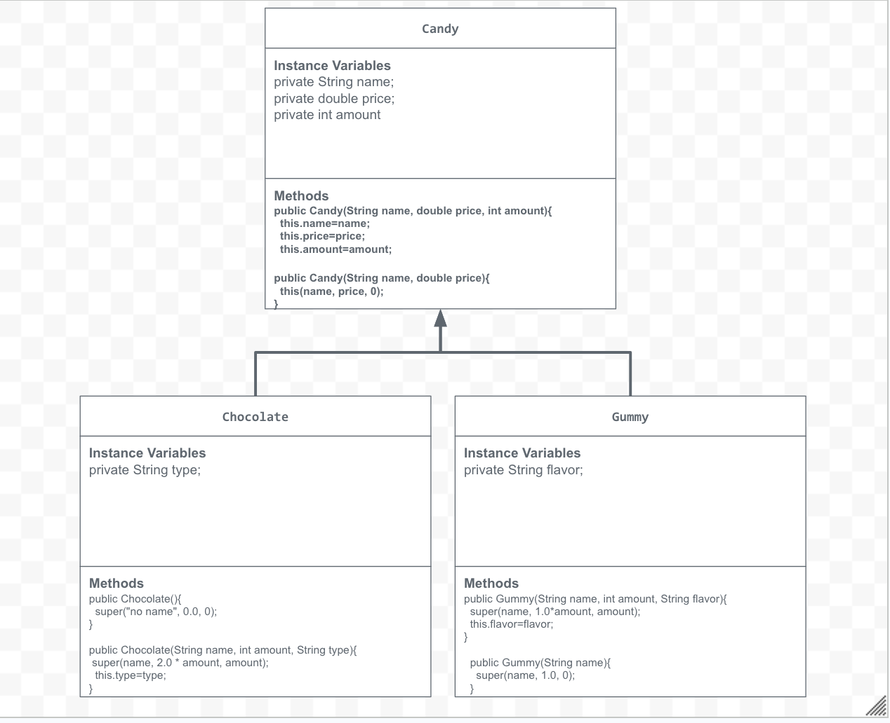

# store-management-project
A candy store using JavaLab
# Unit 2 - Store Management Project

## Introduction

You are opening a new business in your community! Businesses often need programs to manage the products and services they offer and track orders and requests from customers. Your goal is to create a store management system for your business.

## Requirements

Use your knowledge of object-oriented programming and class structure and design to create your store management system:
- **Create a class hierarchy** – Develop a superclass that represents a product or service your business offers and one or more subclasses that extend the superclass to represent more specific types of products or services.
- **Declare instance variables** – Declare instance variables in the superclass that are shared with the subclasses and instance variables in the subclasses that are not shared with the superclass.
- **Write constructors** – Write no-argument and parameterized constructors in the superclass and subclasses. Subclass constructors use the super keyword to call the superclass constructor.
- **Implement accessor and mutator methods** – Write accessor and mutator methods for instance variables that should be accessible and/or modifiable from outside of the class.
- **Implement a toString() method** – Write toString() methods in the superclass and subclasses that return information about the state of an object.

## UML Diagram

Embed your UML Diagram here. Upload the image of your UML Diagram to your repo, then use Markdown to insert your image here:

## Description

1. Write a description of your project here. Include what your store you made, and why you chose this topic. In your description, include as many vocab words from our class to explain how you represented the item/service from your store. If you have user input, explain how the user will interact with your store such as which questions are prompted to the user, what response is your program expecting, and how that is used to output information for your store in the console.

My project was a candy store. Candy was the super class. The candy store sold chocolate and gummies, the 2 subclasses. I picked this because candy stores are very popular. I built different methods to assign instance variables, like the name, price, amount, or flavor of the candy. When the program was run, the code would ask the user to enter "1" if they wanted to buy chocolate, and "2" if they wanted gummies. Based on their answer, it would continue to ask then different questions about the candy, then display the candy, price, and amount they bought. 

2. How is this project related to STEAM (Science, Technology, Engineering, Art, and Mathematics)? Provide explicit examples from the project and details as possible. 

This project is related to STEAM because it is a lot of problem solving, likein math, engineering, and science. I would try something, it would give me an error, then I would fix it. We used technology to write the code, and had to use artistic thinking to find what store to do and what it would sell.

3. What SLOs did you demonstrate during completing this project?

Some SLOs I demonstrated was learning how to make methods inside sub and superclasses. Assigning the variables helped me ask questions and take inputs from the user.